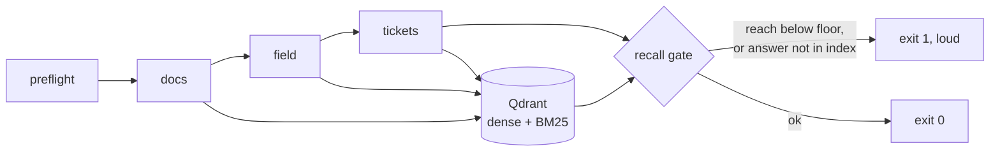

# grounding-layer

**A scheduled refresh that keeps product and field sources current in Qdrant, and tells you when it stops being true.**

Every asset an agent writes is only as good as the index under it. This kit syncs three kinds of
source into one hybrid collection, removes what the sources retired, and ends each run with a
recall gate against a frozen golden set.

Built on [field-kit](https://github.com/meinsta/field-kit).

## Get started

```bash
git clone https://github.com/meinsta/grounding-layer && cd grounding-layer
pip install -r requirements.txt
python3 test_offline.py                       # no cluster, no keys

export QDRANT_URL=... QDRANT_API_KEY=...      # a Qdrant Cloud cluster with Cloud Inference
python3 -m grounding.refresh
```

Schedule it weekly:

```
0 7 * * 1  cd <checkout> && python3 -m grounding.refresh >> refresh.log 2>&1
```

## Meet Quillfeather

Quillfeather Dispatch is a made-up delivery-routing API. The fixtures hold what a real company has:

| Source | Fixture | How it arrives |
|---|---|---|
| Product docs | `fixtures/docs/*.md` | Read directly, one row per sentence |
| Field notes | `fixtures/field/calls.json` | Read directly, described by segment and vertical |
| Support tickets | `fixtures/tickets-response.json` | Through a connector only a signed-in session can call |

`fixtures/golden.json` holds 10 questions and the 11 sentences that answer them.

## How a run works



| Step | What it guarantees |
|---|---|
| Preflight | The cluster answers before anything is touched. A blocking failure halts; the bridge is advisory. |
| Sync | A row is embedded once. A sentence the source dropped leaves the index. A source that fails or returns nothing keeps its last build. |
| Bridge | A call the run cannot make is queued. The source reports PENDING until a session fulfils it. |
| Recall gate | The ceiling comes first: a golden answer missing from the index fails the run at any score. Then reach against the floor (`GROUNDING_RECALL_FLOOR`, default 0.8). |

## Fulfil the queued source

The first run reports `tickets: PENDING`. Store the connector's raw result under the queued key:

```bash
python3 -m fieldkit.bridge --pending
python3 -m fieldkit.bridge --fulfil <key> --from-json fixtures/tickets-response.json
python3 -m grounding.refresh
```

In production a headless session issues the queued calls and `--from-transcript` stores them.

## Make it yours

Replace the three generators in [`grounding/sources.py`](grounding/sources.py). A row is
`{text, source, ref, ...payload}`. Then freeze your own golden set: questions your team gets, and
the exact sentences that answer them.
