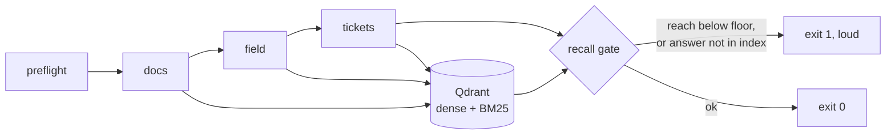

# grounding-layer

**Keep product and field sources current in Qdrant on a schedule, with a recall gate that reports every drop.**

When did the index under your agent last check its sources? If the docs team edited a sentence
yesterday and the index was built last month, the agent is still quoting the old one.

This kit syncs your sources into a Qdrant hybrid collection, removes the rows the sources retired, and
ends each run by asking a frozen set of golden questions. When an answer goes missing, the run
says so and exits 1.

Built on [field-kit](https://github.com/meinsta/field-kit), which lists the other kits that read
this collection.

## Run It on the Sample Company

```bash
git clone https://github.com/meinsta/grounding-layer && cd grounding-layer
pip install -r requirements.txt
python3 test_offline.py                       # runs offline

export QDRANT_URL=... QDRANT_API_KEY=...      # a Qdrant Cloud cluster with Cloud Inference
python3 -m grounding.refresh
```

Schedule it weekly with cron:

```
0 7 * * 1  cd <checkout> && python3 -m grounding.refresh >> refresh.log 2>&1
```

## Learn on a Made-Up Company Called Quillfeather

Quillfeather Dispatch is a fictional delivery-routing API. Its fixtures cover the sources a company
already has, and this table shows how each reaches the index.

| Source | Fixture | How It Arrives |
|---|---|---|
| Product docs | `fixtures/docs/*.md` | Read from disk, one row per sentence |
| Field notes | `fixtures/field/calls.json` | Read from disk, described by segment and vertical |
| Support tickets | `fixtures/tickets-response.json` | Through a connector that needs a signed-in session |

`fixtures/golden.json` holds 10 questions and the 11 sentences that answer them.

## Know What Each Refresh Guarantees



The run has four steps, and each one makes a promise you can test.

| Step | Guarantee |
|---|---|
| Preflight | The cluster answers before the run touches anything. A cluster failure halts the run, and the bridge check is advisory. |
| Sync | The run embeds each row once. A sentence the source dropped leaves the index. A source that fails or returns zero rows keeps its last build. |
| Bridge | The run queues a call that needs a signed-in session, and its source reports PENDING until a session fulfills it. |
| Recall gate | The ceiling comes first: a golden answer missing from the index fails the run at any score. Then the run holds the hit rate at k=3 to the floor (`GROUNDING_RECALL_FLOOR`, default 0.8). |

## See the Results Measured on a Live Cluster

These numbers come from a Qdrant Cloud cluster with the fixtures as shipped: 23 points, 10
questions, and hybrid search (dense and BM25, fused with RRF). A question counts as answered when
every sentence that answers it is in the top k.

| Top K | Questions Answered | Missed |
|---|---|---|
| 1 | 7 of 10 | The rate-limit question, whose answer takes two sentences, and the webhook and EU questions, which rank another sentence first |
| 3 | 9 of 10 | "How do we verify a webhook is really from Quillfeather?" |
| 5 | 10 of 10 | None |

The gate runs at k=3, so the shipped fixtures pass at 0.90 against a floor of 0.80. A second run
embedded zero new rows and removed zero.

## Bring In Sources That Need a Signed-In Session

The first run reports `tickets: PENDING`. Store the connector's raw result under the queued key:

```bash
python3 -m fieldkit.bridge --pending
python3 -m fieldkit.bridge --fulfil <key> --from-json fixtures/tickets-response.json
python3 -m grounding.refresh
```

In production, a headless session issues the queued calls and `--from-transcript` stores each raw
result.

## Point It at Your Own Sources

Replace the generators in [`grounding/sources.py`](grounding/sources.py). A row is
`{text, source, ref, ...payload}`. Then freeze your own golden set: the questions your team gets,
and the exact sentences that answer them.
